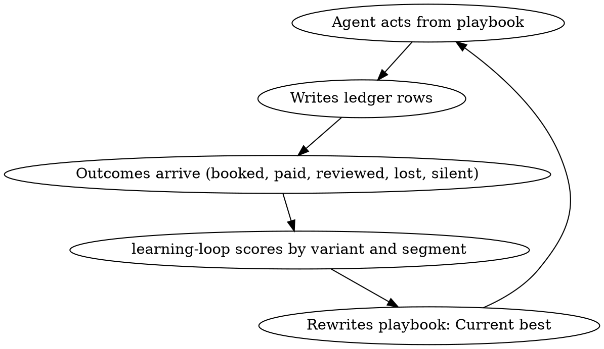

# Feedback Loop

The loop is what makes this an engine rather than a to-do list.

## 1. Every action carries a variant

An agent never sends "a follow-up". It sends follow-up variant `qc-fu1-v3` to segment `domestic/CV4/deep-clean`. The variant ID and segment go on the ledger row. Without them nothing can be compared.

Variant IDs: `<agent-prefix>-<step>-v<n>`. Prefixes: `lr` lead-responder, `qc` quote-closer, `pr` prospector, `la` local-authority, `ce` content-engine, `rp` reputation, `od` ops-dispatcher, `rr` retention-referral, `cc` cash-collector, `cr` capacity-recruiter.

## 2. Outcomes close the row

An outcome row references the original `row_id`. Outcomes: `replied`, `quoted`, `booked`, `lost`, `completed`, `paid`, `reviewed`, `renewed`, `churned`, `referred`, `no_reply`. `no_reply` is written automatically by the agent that owns the next step when its wait window expires. Silence is data.

## 3. One live experiment per agent

- Each agent runs exactly one experiment at a time, listed in the `experiments` tab: `agent | hypothesis | control_variant | test_variant | segment | metric | min_sample | start | decision_rule | status`.
- Traffic split 50/50 unless the playbook says otherwise.
- Minimum sample before a decision: 30 outcomes per arm, or 14 days, whichever comes first for lead-facing variants. Content variants: 10 posts per arm.
- Decision rule is written before the experiment starts. Default: test wins if its metric beats control by 15% relative with the minimum sample met.
- Kill rule: if test is 30% worse than control after half the sample, stop it the same day.
- When an experiment ends, the next one starts within the same learning-loop run. An agent with no live experiment is a bug.

## 4. Monday learning-loop run

1. Pull last 7 days and last 28 days of ledger rows.
2. For every agent: compute each metric per variant and per segment (postcode, service, source, client type).
3. Decide each live experiment against its rule. Promote winners into the playbook's `Current best`. Move losers to `Retired` with the number that killed them.
4. Find the week's bottleneck stage (scoreboard.md). Write one new experiment aimed at it, assigned to the agent that owns that stage.
5. Find any segment that outperforms its peers by 25%+ on close rate or job value. Write a `Learned` entry and tell growth-director to shift effort there (coverage-map.md).
6. Append `Learned` entries to each playbook: date, what was observed, the number, what changed. Never delete history.
7. Write the scoreboard tab for the week.
8. Hand growth-director the allocation for the week.

## 5. Playbook rewrite rules

- A playbook has four sections: `Current best`, `Live experiment`, `Learned`, `Retired`. The agent reads `Current best` and `Live experiment` only.
- Only learning-loop and Taka edit `Current best`. Agents append to `Learned` when something happens mid-week that cannot wait (a complaint, a legal change, a competitor move).
- Every change in `Current best` cites a ledger metric or a Taka instruction. "Felt better" is not a citation.
- Keep `Current best` under 300 words. If it is longer, the agent will skim it.

## 6. Trigger-driven runs

learning-loop also runs on the same day when:
- Any scoreboard metric moves 20%+ day on day.
- A complaint, refund, or 1-3 star review lands.
- growth-director asks, with a reason.

## 7. Monthly

First Monday of the month, learning-loop also runs `anthropic-skills:competitor-intel` and updates `coverage-map.md` with the month's wins and gaps per postcode.
